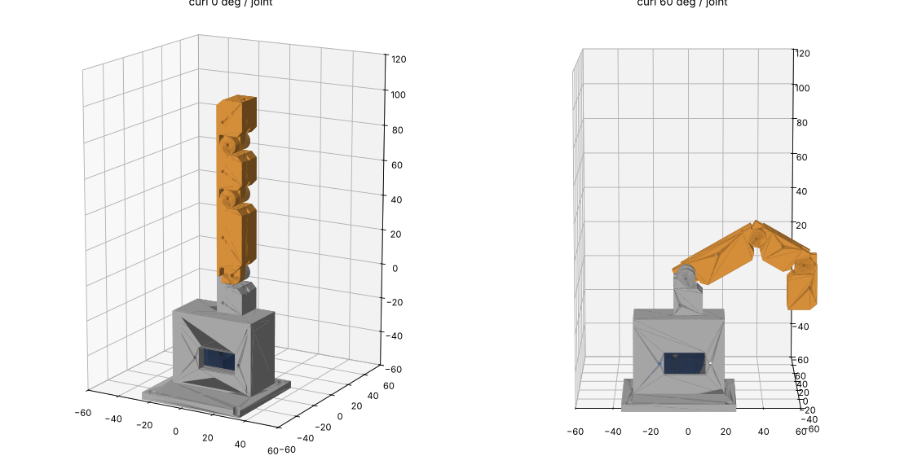

# RoboHand: a wireless, 3D-printed robotic hand (beginner build)

This project is a robotic hand, and later a full arm, whose fingers bend the way real ones
do. **Strings ("tendons") pulled by small motors** do the bending, and you control it
**wirelessly from your phone** (and later by moving your own hand in front of a webcam).

It is designed for someone with a 3D printer and little electronics experience:

- **No soldering.** Every electrical connection is a plug or a screw terminal.
- **Cheap.** The first finger costs about **$15–25** in parts (see the shopping list).
- **One finger first.** When one finger works, the other four are copies of it.



## The roadmap

| Step | What you do | Guide |
|---|---|---|
| 0 | Learn the 10 ideas you need (servo, tendon, ESP32, power, ground, connectors) | [01-basics.md](docs/01-basics.md) |
| 1 | Buy the parts for one finger | [02-shopping-list.md](docs/02-shopping-list.md) |
| 2 | Print the finger + base + spool while the parts ship | [03-print-and-assemble.md](docs/03-print-and-assemble.md) |
| 3 | Set up the Arduino IDE, wire one servo, make it move from your phone | [04-wiring-and-first-test.md](docs/04-wiring-and-first-test.md) |
| 4 | Mount the servo, thread the tendon, **calibrate**, control the finger wirelessly | [03](docs/03-print-and-assemble.md) + [04](docs/04-wiring-and-first-test.md) |
| 5 | Five fingers + palm (more servos, external 5 V supply) | *next* |
| 6 | Wrist and forearm (bigger servos) | *later* |
| 7 | Hand copies your hand through a webcam (MediaPipe → WiFi → ESP32) | *later* |

## What's in this folder

```
robot-hand/
  docs/                      Step-by-step guides (start with 01-basics.md)
  cad/generate_parts.py      Parametric generator for every printed part (Python)
  cad/render_preview.py      Renders the preview picture + checks parts don't collide
  cad/stl/                   Ready-to-print STL files (already oriented for printing)
  sim/finger_sim.py          Physics simulation (MuJoCo): motion, servo load, grip, strength
  firmware/finger_control/   ESP32 Arduino sketch: WiFi + phone slider + serial commands
```

## Status

- **Printable parts:** generated and checked in software. Every part is a closed,
  printable solid, each joint curls about 85° with a 3° stop against bending backwards,
  and the finger, spool and servo don't collide with the base. **They have not been
  test-printed yet**, so expect small fit tweaks after your first print. Print tolerances
  are all at the top of `generate_parts.py`.
- **Simulation:** the finger was checked in the MuJoCo physics engine (see
  [`sim/README.md`](sim/README.md)). That found 4 flaws in the first design: joints snapping,
  the finger falling closed palm-down, not enough string travel, and a pinched string. All 4
  are fixed in the current parts. Result: smooth curl, fully closed at ~165° servo turn,
  ~35 % of the servo's stall force, pins ~4× stronger than needed.
- **Firmware:** written for the ESP32 Arduino core with the ESP32Servo library. **It has
  not been compiled or run on real hardware yet.** Step 3 is where we check it together.
