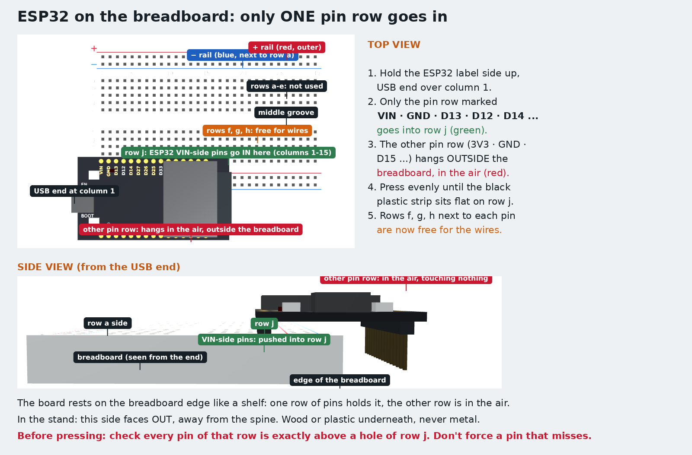

# 04 · Wiring and first wireless test (one servo)

Goal of this step: **move one servo from your phone.** You don't need the finger attached
yet. Doing the electronics on their own first means that if something doesn't work, we
know it's the electronics and not the mechanics.

## A. Install the software (one time, about 15 minutes)

1. Install **Arduino IDE 2** from arduino.cc/en/software.
2. Add ESP32 support:
   - *File → Preferences → Additional boards manager URLs*, paste:
     `https://espressif.github.io/arduino-esp32/package_esp32_index.json`
   - *Tools → Board → Boards Manager*, search **esp32** by *Espressif Systems*, then click **Install**.
3. Add the servo library: *Tools → Manage Libraries*, search **ESP32Servo**, then click **Install**.
4. Plug the ESP32 into your laptop with the **data** USB cable.
   - Under *Tools → Port* a new port should appear (`COM3`… on Windows, `/dev/cu.usbserial…`
     or `/dev/cu.SLAB…` on Mac).
   - **No new port?** Look at the small chip next to the USB socket on the board:
     - It says **CP2102** → install the "CP210x USB to UART driver" from Silicon Labs.
     - It says **CH340** → install the "CH340 driver" from WCH.
     - Still nothing → try another cable (it's probably charge-only).

## B. Wire it up (power OFF: USB and power supply unplugged)

Your ESP32 is **wide**: pushed across the middle groove, it covers every hole. So only **one** of its pin rows
goes into the breadboard and the other row hangs in the air past the edge. Every pin we use is on the VIN side,
so that is the row that goes in. Video: `video/wiring_inboard/robohand_wiring_esp32_on_board.mp4`.
Checked in `cad/wiring_fit.py`: it works whether the board's pin rows are 0.9, 1.0 or 1.1 inch apart.

```
 far long side:   ── + rail (red line, outer) ───────────────────────
                  ── − rail (blue line, next to row a) ─────────────     <- use these two rails
 rows a-e          (not used)
 ─────────────── middle groove ───────────────
 row f  (wires):  col 1   col 2   col 3   col 4   col 5   col 6   col 7   col 8
 rows g, h        free    free    free    free    free    free    free    free
 row j  (pins):   VIN     GND     D13     D12     D14     D27     D26     D25  ... (USB end at column 1)
 ESP32 board hangs out over this edge, its other pin row in the air
```



1. **ESP32:** USB end over **column 1**. Put the **VIN-side pins into row j**, columns 1–15. The rest of the
   board hangs out over the edge. Check every pin is over its hole, then press evenly until the black strip
   sits flat. The other pin row must hang in the **air** and touch nothing. The rails under the board are not used.
2. **Power adapter:** **two** red jumpers side by side in the adapter's **+** screw terminal, **two** black
   jumpers in **−** (the servos can draw ~2.5 A together; one thin jumper alone gets warm and drops voltage).
   Tighten the screws and tug each jumper. On the **far** long side (next to row a): red jumpers into the rail
   with the **red line**, black into the rail with the **blue line**. Follow the colours, not the position: on
   this breadboard the blue (−) rail is the one nearer row a. Double-check: red = + on the adapter.
3. **Capacitor 1000 µF:** long leg into the + rail, striped side (short leg) into the − rail.
4. **Shared ground:** black jumper from **row f, column 2** (GND) into the − rail.
5. **Servo (index):** push 3 male-male jumpers into its plug (brown, red, orange) and tape the joint.
   Brown into the − rail, red into the + rail, **orange into row f, column 3** (D13).
6. **Columns 1 (VIN) and 4 (D12) stay empty.** Servos get power only from the 5 V 3 A supply.
   **All five at once:** the video continues with middle (D14 → row f, column 5), ring (D27 → column 6),
   little (D26 → column 7) and thumb (D25 → column 8), each with brown → −, red → +. After power-on, test one
   slider at a time: only that finger's servo may turn.
7. **In the stand:** breadboard in its pocket with the **ESP32 side facing out**, away from the spine (facing the
   spine it would hit the socket). The ESP32 sticks out over the edge of the stand. Work on wood or plastic, never metal.

The pin labels are printed on the board (`D13`, `GND`, ...). Before pressing it in, check that **your** board
reads VIN, GND, D13, D12, D14, D27, D26, D25 from the USB end. **Never use D12** (it affects booting).

*Alternative* (if it ever doesn't hold): the ESP32 lies beside the breadboard on female-male jumpers, video
`video/wiring_fm/robohand_wiring_esp32_beside.mp4`.

## C. Upload the code

1. Open `firmware/finger_control/finger_control.ino` in Arduino IDE. It's set up for the
   full hand. For this first test only the servo on **pin 13 (index)** is connected; the others
   simply aren't plugged in yet.
2. *Tools → Board → esp32 → **ESP32 Dev Module***, and *Tools → Port →* your port.
3. Click **Upload** (→ arrow).
   - If it gets stuck at `Connecting.....`, **hold the BOOT button** on the ESP32 until the
     upload starts.
4. Open *Tools → Serial Monitor* and set it to **115200 baud**. You should see:
   ```
   RoboHand starting
   WiFi network: RoboHand   open http://192.168.4.1
   ```
   The servo moves to its start ("open") angle.

**Power-on order (every time):** first plug in the **5 V supply**, then the **USB** cable. That way the
servos already have power when the ESP32 starts, and it switches them on one after another (gentle
on the supply). To switch off: USB out, then the supply. A single twitch of the middle-finger servo
(pin 14) at power-up is normal.

## D. Control it from your phone

1. On your phone, join the WiFi network **RoboHand**, password **robohand123**.
   (The phone may warn "no internet". Choose to stay connected.)
2. Open a browser and go to **http://192.168.4.1**
3. Move the **Index** slider. The servo should follow. 🎉

**This is your first wireless robot control.**

## E. Calibrate (after the finger and tendon are mounted, see guide 03)

**Calibrate before you use "Close all" or the gesture buttons.** Until then the firmware uses safe
closing angles (about 88 % closed) so no finger can be pushed against its end stop.

In the Serial Monitor, type raw angles for one finger and watch it. Finger numbers are
0 thumb, 1 index, 2 middle, 3 ring, 4 little:

```
a 1 90       <- move the index servo to 90 degrees
a 1 30
a 1 150
```

1. Find the angle where the finger is **just straight** with the line barely tight, e.g. 25.
2. Find the angle where the finger is **fully curled** but the servo isn't straining or
   buzzing, e.g. 150.
3. Put those numbers in the code and upload again:
   ```cpp
     {"Index",  13, 25, 170},
   ```
   (A finger needs about **160°** of servo travel on the spool, the thumb about **105°**.)
   (If the finger closes when the angle goes *down*, just swap them, e.g. `150, 25`. The
   code works either way.)

Now 0 % on the slider means fully open and 100 % means fully closed.

## Troubleshooting

| Symptom | Likely cause | Fix |
|---|---|---|
| Servo doesn't move at all | Signal in the wrong hole / no common ground | Orange must be in row a, next to D13. GND jumper to the − rail |
| Servo jitters / twitches | Weak power or loose jumper | Use the separate 5 V supply + capacitor, re-seat the jumpers |
| ESP32 reboots when the servo moves (Serial Monitor shows "RoboHand starting" again) | Servo drawing too much from USB | Switch to the separate 5 V supply |
| Phone can't find "RoboHand" | Board unplugged, phone's list not refreshed, or a crowded WiFi channel | Keep USB plugged in (the network only exists while the ESP32 has power). Serial Monitor must say `WiFi started OK`; type `wifi` to see the status. Turn the phone's WiFi off and on, hold it next to the board, check the laptop's WiFi list too. Still nothing: type `scan` (does the ESP32 hear your home WiFi?), then `wifi low` / `wifi full` (transmit power; low is the default because full power can make cheap boards' regulators dip), or change `WIFI_CHANNEL` (6) to 1 or 11 and upload again |
| Page won't open | Phone using mobile data instead | Turn mobile data off, or answer "stay connected" |
| Servo buzzes loudly at the end of travel | Pushing past the finger's limit | Move `closedAngle` a few degrees back |

## Next step

When the servo moves from your phone, the electronics work. Go to
[guide 05](05-full-hand.md) to build the full hand. The firmware is already set up for 5
fingers, and the servo you just tested on pin 13 is the **index** finger.
