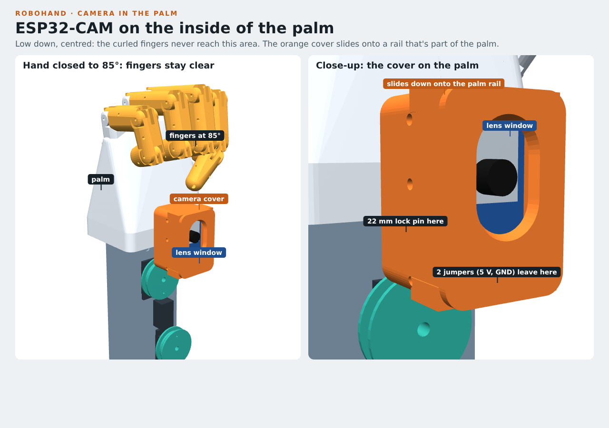

# 06 · Camera in the palm (ESP32-CAM)

A small camera sits in the centre of the **inside of the palm**, low down where the
fingers never reach, even in a full fist (checked at every angle, 0–90°, for all five fingers and the thumb).
It looks out of the palm, at whatever the hand is about to grab, and streams video over WiFi.

## How it attaches

- The **palm** (plate 3) has a short **slide rail** on its inside face, just above the wrist.
  It's part of the palm print, so you don't need to do anything extra.
- The **camera cover** (plate 7) holds the ESP32-CAM. It slides **down** onto the rail until it
  stops, and **one filament pin** (22 mm) through the two small holes under the rail locks it.
  Pull the pin and slide the cover up to take it off.
- The board is held from behind by **3 pieces of 2 mm rubber cord**, the same cord as the fingers.
  No glue, no screws.

## Buy

| Item | Link | Pick | ≈ € |
|---|---|---|---|
| **ESP32-CAM with ESP32-CAM-MB** programmer board | [amazon.de: ESP32-CAM MB](https://www.amazon.de/s?k=ESP32-CAM+MB+OV2640) | "AI-Thinker" ESP32-CAM **with** the "MB" USB board (you need it to upload code). Check whether its USB is Micro-USB or USB-C, and that you have that cable | 10–14 |
| **Jumper wires female-male, 40 cm** | [amazon.de: Jumper Kabel female male 40cm](https://www.amazon.de/s?k=Jumper+Kabel+female+male+40cm) | 2 are needed (5 V and GND from the breadboard up to the palm) | 4–6 |

## Print: plate 7 (`cad/plates/plate_7_palm_camera.3mf`)

Standing upright on its bottom, as laid out in the file (that's how it sits on the palm). **No supports**. 3 walls, 20 % gyroid, brim off.
About 6 g and 40 minutes.

## Fit it

1. **Plug the 2 jumpers in first:** the female ends go on the camera's **5V** and **GND** pins
   (printed next to the pins on the board). The jumper plugs fit in the gaps beside the rail.
2. **Board into the cover:** camera side facing the front window, **antenna end (the end with the
   zig-zag track) at the top**. The 4 corners sit in the small corner steps.
3. **Rubber cords:** thread 3 pieces (each ~10 cm) through the pairs of side holes, across the back of
   the board. Pull them snug and knot them outside the cover. If the board is loose, pull tighter.
4. **Wires out:** the two jumpers leave through the slots in the bottom of the cover.
5. **Onto the palm:** with the fingers **straight**, slide the cover down over the rail from above
   until it stops. Push a **22 mm filament pin** through the two holes under the rail. Melt the ends
   lightly like the joint pins.
6. **Wiring:** run the 2 jumpers down the front of the spine (tape them) to the breadboard:
   **5V → + rail, GND → − rail**. That's the same 5 V supply as the servos.

## First test

Program it with the Arduino IDE example **File → Examples → ESP32 → Camera → CameraWebServer**
(select board *AI Thinker ESP32-CAM*, put the camera on the MB board, plug in USB). Put in your WiFi
name and password, upload, then open the IP address shown in the Serial Monitor. If the picture is upside
down, tick **V-Flip** / **H-Mirror** on the web page. Next step: a sketch that sends the video to the Pi/PC
so the hand can react to it.

## Notes

- The OV2640 lens is fixed-focus: sharp from about 30 cm, so close objects look soft. A "wide-angle 160°"
  OV2640 module (~€5) can be swapped in on the same connector if you want to see more.
- The lens window is tall (24 mm). If your board's lens sits higher or lower than the
  middle, it will still look through the window. The camera module is stuck on with a sticky pad
  and can also be moved a little on its cable.
