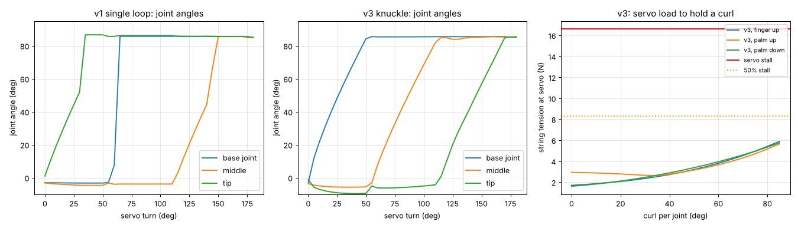

# Finger simulation: will it work?

`finger_sim.py` builds the finger in the **MuJoCo** physics engine using the same dimensions
as `cad/generate_parts.py`, then runs these tests:

| Test | Question |
|---|---|
| A. Servo sweep | Turn the servo 0 → 180°. Do the joints bend smoothly, and does the finger close fully? |
| B. Holding still | With the servo relaxed, does the elastic keep the finger straight against gravity (finger up, palm up, palm down)? |
| C. Servo load | How hard must the servo pull to curl the finger, including string friction in the channels? |
| D. Friction sensitivity | What if the string slides worse than expected? |
| E. Grip | Close the finger on a 24 mm bar. How hard does it squeeze? |
| F. Strength | At full servo stall, are the filament pins and printed tongues strong enough? |

```bash
pip install mujoco numpy matplotlib manifold3d trimesh
```

```bash
python finger_sim.py
```

The output goes to `results/report.txt` and `results/finger_sim.png`.



## What the simulation found, and what was changed

The first design (**v1**) would **not** have worked well:

| Problem found | Why | Fix (now in the CAD) |
|---|---|---|
| Joints **snap closed one at a time** (0° → 85° jumps) | One elastic loop ran over all joints, and its leverage **shrinks** as a joint bends, so once a joint starts moving it gets easier and easier | **v3:** a separate elastic section for every joint, held by **lock pins**, wrapping over a **rounded groove in each knuckle**, so the leverage stays constant |
| Finger **falls closed** when the hand is palm-down | 1 mm elastic too weak to hold the finger's own weight | 2 mm elastic cord stretched ~50 % |
| Finger **can't close fully** | It needs **37.5 mm** of string, and the 10 mm spool only gives 31 mm in 180° | Spool radius **13 mm** → 41 mm in 180° (the finger closes at ~165°) |
| String **pinched** between the bones when a joint is fully closed | The string exits meet at ~85° | Small **groove** at every joint face |

## Results for the current design (v3)

| Check | Result | Verdict |
|---|---|---|
| Joint motion | Smooth and continuous. The base joint bends first, then the middle, then the tip. That's normal for one-string fingers and good for wrapping around objects | ✅ |
| Full close | All joints reach 85° at **165° of servo turn** (180° available) | ✅ |
| Stays open, servo relaxed | Yes in all three orientations (the smallest margin is the base joint, palm down: 3 mN·m) | ✅ (thin margin palm-down) |
| Servo load to curl fully | **~5.9 N = 35 % of MG90S stall** (friction μ = 0.25) | ✅ |
| If the string drags more (μ = 0.35) | 9.2 N = 55 % of stall | ⚠️ OK but warm. Use slick braided line and smooth channels |
| Grip on a 24 mm bar | **~4–7 N** squeeze, about the force of holding a full plastic cup | ✅ for light objects |
| Filament pin at full stall | Shear 6.9 MPa vs PLA ~30 MPa → **4.3× safety** | ✅ |
| Tongue bearing | 3.2 MPa vs ~40 MPa → **12× safety** | ✅ |

## What the simulation can't prove

This is a strong check, but **no simulation is flawless**. These things are only
estimated or left out:

- **String friction** is a textbook estimate (μ 0.15–0.35), not measured on your print.
- **Elastic cord strength** varies a lot by brand. The model assumes rubber (E ≈ 1.5 MPa). You'll
  set the real tension by feel during assembly (see guide 03).
- **Print quality.** Rough channels add friction, and tight pin holes add joint friction.
- **Pin wear** over thousands of cycles, and **creep** of PLA under constant elastic tension (PETG resists it better).
- **Servo behaviour.** Cheap MG90S clones vary in torque, travel and dead-band.
- **Contact** in the grip test is idealised (the bones are boxes).

The real test is the one-finger rig, which is exactly why we build one finger first. If
the real finger behaves differently, tell me what you see (stiff, floppy, doesn't close,
snaps), and I'll adjust the parameters and re-run the simulation.
